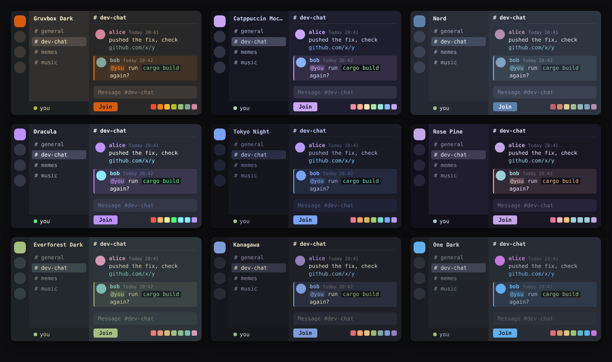

# dorion-themes

A handful of dark themes for [Dorion](https://github.com/SpikeHD/Dorion), the
lightweight Discord client. They should work in other clients that load
BetterDiscord-style CSS too.



| Theme            | File                                                              |
| ---------------- | ----------------------------------------------------------------- |
| Gruvbox Dark     | [gruvbox-dark.theme.css](themes/gruvbox-dark.theme.css)           |
| Catppuccin Mocha | [catppuccin-mocha.theme.css](themes/catppuccin-mocha.theme.css)   |
| Nord             | [nord.theme.css](themes/nord.theme.css)                           |
| Dracula          | [dracula.theme.css](themes/dracula.theme.css)                     |
| Tokyo Night      | [tokyo-night.theme.css](themes/tokyo-night.theme.css)             |
| Rosé Pine        | [rose-pine.theme.css](themes/rose-pine.theme.css)                 |
| Everforest Dark  | [everforest-dark.theme.css](themes/everforest-dark.theme.css)     |
| Kanagawa         | [kanagawa.theme.css](themes/kanagawa.theme.css)                   |
| One Dark         | [one-dark.theme.css](themes/one-dark.theme.css)                   |

## Install

Drop any `.theme.css` file into your Dorion themes folder and pick it in
Settings → Themes.

- Windows: `C:\Users\<you>\dorion\themes\`
- Linux: `~/.config/dorion/themes/`

Or use **Install Theme from Link** in Dorion's theme settings and paste a
raw URL, e.g.

```
https://raw.githubusercontent.com/maestrogl/dorion-themes/main/themes/gruvbox-dark.theme.css
```

## Font

All themes use a monospace font. Dorion can't load web fonts on every
platform, so the themes use whatever you have installed, in this order:

JetBrains Mono, Cascadia Code, Fira Code, Iosevka, Source Code Pro, Hack,
Ubuntu Mono, DejaVu Sans Mono, Consolas, Menlo.

To change it, edit `--t-font` at the top of the theme. To go back to
Discord's default font, set it to `"gg sans", "Noto Sans", sans-serif`.

## Tweaking

Each theme starts with a short palette block (`--t-bg`, `--t-accent`, etc.)
you can edit directly.

If you want to change all of them at once, the themes are generated from
`src/template.css` and `src/palettes.json`:

```sh
python3 build.py
```

## Credits

Colours come from the original projects:
[Gruvbox](https://github.com/morhetz/gruvbox),
[Catppuccin](https://github.com/catppuccin/catppuccin),
[Nord](https://github.com/nordtheme/nord),
[Dracula](https://github.com/dracula/dracula-theme),
[Tokyo Night](https://github.com/folke/tokyonight.nvim),
[Rosé Pine](https://github.com/rose-pine/rose-pine-theme),
[Everforest](https://github.com/sainnhe/everforest),
[Kanagawa](https://github.com/rebelot/kanagawa.nvim),
[One Dark](https://github.com/atom/atom/tree/master/packages/one-dark-syntax).

## License

MIT
